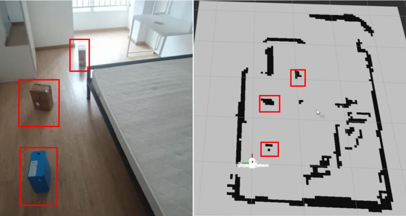
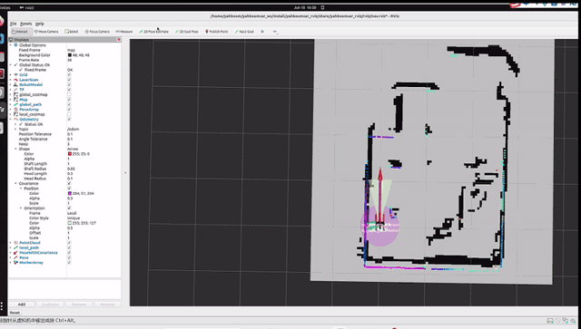
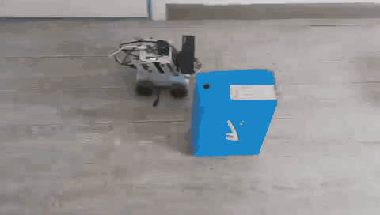
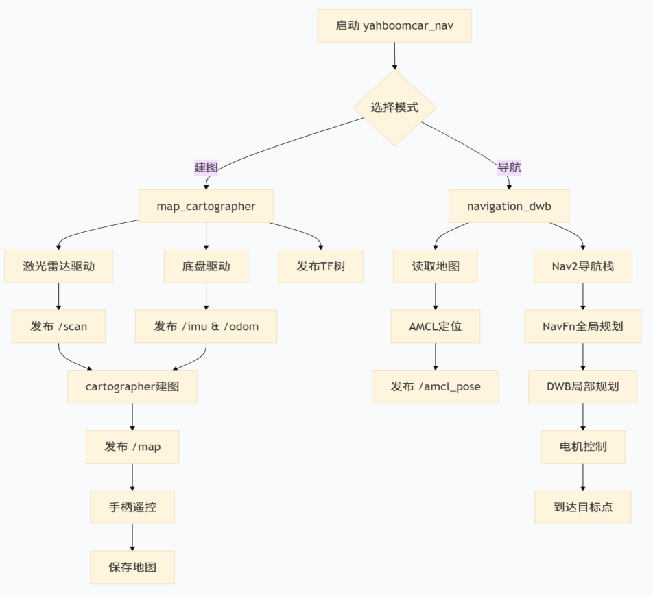

# 基于 ROS2 的移动机器人建图与自主导航

面向室内移动机器人导航任务，完成从激光建图、地图保存与加载，到初始定位、路径规划、障碍物绕行和目标点到达的完整流程。项目采用 ROS2 Humble、Cartographer 与 Nav2，在麦克纳姆轮移动平台上完成部署、配置联调和真机演示。

技术关键词：ROS2 · Cartographer · Nav2 · AMCL · NavFn · DWB · 激光雷达 · 真机部署

## 效果展示

### 室内建图

通过键盘遥控机器人遍历室内环境，在 RViz2 中实时观察激光扫描和地图更新，生成二维占据栅格地图。实验地图呈现了墙体、家具和纸箱障碍物的轮廓，保存为 PGM 与 YAML 文件后用于导航。



### 目标点导航与避障

加载已建地图后，在 RViz2 中设置机器人初始位姿与目标点。系统生成全局路径，并通过局部控制指令驱动机器人绕过纸箱障碍物，完成室内单目标点导航。

**RViz2 实时导航演示**



**实机导航演示**



## 完成的工作

- 部署与联调：完成 Ubuntu 22.04 与 ROS2 Humble 运行环境配置，组织建图、导航、底盘控制及可视化功能包，打通从传感器输入到机器人运动执行的流程。
- 建图应用：配置并运行 Cartographer 建图流程，通过遥控采集室内激光数据，观察地图更新，完成地图保存和后续加载。
- 导航配置：联调 AMCL 定位、NavFn 全局规划、DWB 局部控制和代价地图，完成初始位姿设置、目标下发与导航执行。
- 参数调试：围绕雷达有效范围、扫描匹配、运动滤波、速度限制和障碍物膨胀范围进行配置与调试，结合地图和机器人运动表现检查效果。
- 真机验证：在包含家具和纸箱障碍物的室内场景中执行建图与导航实验，保留地图、RViz2 截图和实物演示视频。

## 硬件与软件环境

硬件平台：四轮麦克纳姆轮全向移动底盘、RDK X5 上位机、MS200 单线激光雷达，以及 STM32F103RCT6 下位机。

软件环境：Ubuntu 22.04 LTS、ROS2 Humble、Cartographer ROS、Nav2 与 RViz2。

## 系统方案

### 建图流程

激光雷达提供环境扫描，轮式里程计提供运动信息；Cartographer 完成扫描匹配与地图构建，输出供 RViz2 显示的二维栅格地图。建图完成后保存地图，供后续定位和导航复用。

数据流程：激光扫描与轮式里程计 → Cartographer → 二维栅格地图 → 地图保存

### 导航流程

AMCL 根据已建地图、激光扫描和运动信息估计机器人位姿；NavFn 计算通往目标的全局路径；DWB 结合路径和局部代价地图选择速度指令，由底盘执行。RViz2 用于设置初始位姿、下发目标以及观察运行过程。

任务流程：加载地图 → 初始化定位 → 设置目标点 → 全局路径规划与局部避障控制 → 到达目标。



## 运行流程

加载环境：

```bash
source /opt/ros/humble/setup.bash
source ~/yahboomcar_ws/install/setup.bash
```

### 1. 启动底盘

在小车端执行：

```bash
ros2 launch yahboomcar_bringup yahboomcar_bringup_launch.py
```

### 2. 启动建图与可视化

在小车端的新终端启动 Cartographer。该入口会启动激光雷达，无需重复启动雷达节点：

```bash
ros2 launch yahboomcar_nav map_cartographer_launch.py
```

在已配置 ROS2 通信的远程电脑上启动建图可视化：

```bash
ros2 launch yahboomcar_nav yahboomcar_mapping_launch.py
```

可在另一个终端检查激光与里程计话题：

```bash
ros2 topic hz /scan
ros2 topic hz /odom
```

### 3. 遥控建图并保存地图

启动键盘控制，使机器人缓慢遍历环境，在 RViz2 中观察地图覆盖情况：

```bash
ros2 run yahboomcar_ctrl yahboom_keyboard
```

建图完成后，保持建图节点运行，在小车端保存地图：

```bash
mkdir -p ~/maps
```

```bash
ros2 run nav2_map_server map_saver_cli \
-f ~/maps/my_map
```

生成以下文件：

```bash
~/maps/my_map.pgm
~/maps/my_map.yaml
```

### 4. 切换至导航模式

地图保存完成后，在建图终端按 Ctrl+C 停止建图，再启动导航并指定地图：

```bash
ros2 launch yahboomcar_nav navigation_dwb_launch.py \
map:=$HOME/maps/my_map.yaml
```

该启动入口加载地图及 AMCL、Nav2 导航组件。底盘节点保持运行。

### 5. 设置位姿与导航目标

在远程电脑启动 RViz2；如果已有窗口，可继续使用：

rviz2

将 Fixed Frame 设置为 map，添加地图、激光和路径显示。使用 2D Pose Estimate 设置机器人初始位置与朝向，再使用 Nav2 Goal 指定目标，观察路径规划、绕障与到达过程。

## 依赖与致谢

建图与导航基于 ROS2、Cartographer 和 Nav2，机器人驱动与平台功能包使用 Yahboom 配套软件相关组件的版权与许可证归原作者所有。
